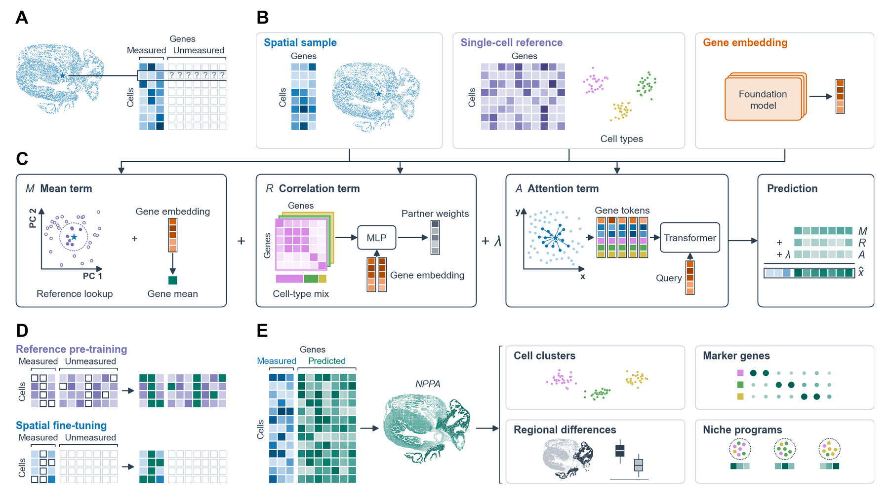

# RESONATE

[](https://github.com/J041120h/RESONATE/actions/workflows/tests.yml)
[](https://j041120h.github.io/RESONATE_tutorial/)
[](LICENSE)

Predict genes that a spatial transcriptomics panel **never measured**, using a matched single-cell reference,
foundation-model gene embeddings and spatial context.

Documentation and tutorial: <https://j041120h.github.io/RESONATE_tutorial/>



*Inputs, model components and training of RESONATE (Figure 1 of the paper). (A) A spatial panel measures a subset of
genes in every cell. (B) Inputs: the spatial sample, a same-tissue single-cell reference and a fixed embedding vector per
gene from a foundation model. (C) The three terms of the prediction. (D) Reference pre-training, then spatial
fine-tuning. (E) The completed matrix, here the predicted expression of NPPA, a gene outside the measured panel of a
fetal-heart MERFISH section, supports downstream analyses.*

---

## What the method does

RESONATE (**RE**constructing **S**patial **O**mics via **N**eighborhood, **A**tlas **T**ransfer and **E**mbeddings)
represents every gene by a fixed foundation-model embedding (scGPT-spatial token embeddings by default). For a spatial
cell *c* and a gene *g* that the panel did not measure, it predicts

    x̂(c, g) = M(c, g) + R(c, g) + λ · A(c, g)

| term | what it uses |
|---|---|
| **M**, mean | a gene mean predicted from the embedding of *g*, averaged with the mean of *g* over the 100 reference cells nearest to *c* in a shared principal-component space |
| **R**, correlation | measured genes positively and negatively correlated with *g* in the reference (up to 128 positive and 8 negative partners per reference cell type), weighted by pair scores from the gene embeddings and reference correlations, and mixed according to the reference cell-type mixture of *c* |
| **A**, attention | one token per measured gene (its embedding, its expression in *c* and in the 15 spatial neighbours of *c*, and the neighbours' reference-type distances), related by a transformer and queried by the embedding of *g*; λ ∈ {0, ¼, ½, ¾, 1} is chosen on measured genes set aside for validation |

Training has two stages: **reference pre-training** (measured genes are inputs; hidden entries of measured and
unmeasured genes are targets), then **spatial fine-tuning** (hidden measured genes are reconstructed in the spatial
cells). After fitting, any gene measured in the reference and present in the embedding table can be predicted without
refitting.

---

## Repository layout

```
RESONATE/
├── pyproject.toml                  # package metadata; `pip install .` installs the `resonate` import and command
├── environment.yml                 # conda environment (Python 3.11, CPU PyTorch; comment shows the CUDA variant)
├── INSTALL.md                      # installation details: CPU, GPU, validated versions
├── CITATION.cff                    # how to cite (software + paper in preparation)
├── CHANGELOG.md
├── LICENSE                         # MIT
├── assets/figure1.png              # overview figure shown above
├── src/resonate/                   # the package
│   ├── __init__.py                 # public API: impute, score, datasets, pl, prepare, fit, predict, Resonate, Prepared, Config, ...
│   ├── quick.py                    # one-call helpers: `impute` (prepare + fit + predict) and `score` (per-gene accuracy)
│   ├── datasets.py                 # `fetal_heart_demo`: download, check and load the demo data
│   ├── pl.py                       # plots: cell types, gene scores, measured vs predicted maps, cell-type heatmap
│   ├── api.py                      # `fit`, the fitted model `Resonate` (predict, save, load), prediction of genes outside the fit targets
│   ├── cli.py                      # `resonate prepare | fit | predict | run | download-embeddings | version`
│   ├── config.py                   # `Config`: every setting, defaults = the paper model
│   ├── embeddings.py               # gene-embedding tables: loaders (.npz/.csv/DataFrame/AnnData), scGPT-spatial extraction
│   ├── metrics.py                  # scoring of held-out genes (Pearson, Spearman, aligned MSE; top-N genes)
│   ├── train.py                    # two-stage training: reference pre-training, spatial fine-tuning, choice of λ
│   ├── toy.py                      # tiny simulated dataset for the tests
│   ├── model/
│   │   ├── model.py                # the network: mean, correlation and attention terms, partner selection
│   │   └── attention.py            # attention term A (gene tokens, transformer encoder, query by the target embedding)
│   └── prep/
│       ├── pipeline.py             # `prepare`: AnnData in, `Prepared` (all model inputs) out
│       ├── neighbors.py            # smoothing, joint PCA space, nearest-neighbour searches
│       ├── reftypes.py             # reference cell types (Leiden on donor-corrected cells) and type distances
│       ├── votes.py                # reference lookups and cell-type mixtures under gene-fold exclusion
│       ├── correlations.py         # pooled, within-type and shrunk type-specific reference correlations
│       └── aux.py                  # auxiliary pre-training targets (highly variable reference genes)
├── tests/                          # unit and end-to-end tests on simulated data (CPU); test_gpu.py runs only with CUDA
├── sample_data/                    # 12 MB MERFISH fetal-heart sample for the quick start and tutorial (see its README.md)
├── equivalence/                    # results of the equivalence check against the paper model (JSON summaries)
└── .github/workflows/tests.yml     # continuous integration: CPU tests on Python 3.10 and 3.11
```

---

## Quick start

Runs on a laptop CPU in about 8 minutes with the demo data (downloaded and checked by `fetal_heart_demo`).

```python
import resonate

spatial, reference, embeddings, held_out = resonate.datasets.fetal_heart_demo("data")

# predict two genes outside the 236-gene panel; also hide 48 panel genes to check accuracy
pred = resonate.impute(spatial, reference, embeddings, genes=["NPPA", "MYL2"], heldout=held_out,
                       device="cpu", max_epochs=12)          # leave out max_epochs (and device on a GPU) for the paper settings
scores = resonate.score(pred, spatial)                     # per-gene Pearson / Spearman on the test cells
resonate.pl.spatial_compare(pred, spatial, scores.index[:4], table=scores)   # measured vs predicted maps
pred.write_h5ad("predictions.h5ad")
```

The tutorial notebook (<https://j041120h.github.io/RESONATE_tutorial/>) runs these steps with their outputs and plots.

### Step by step

```python
spatial, reference, emb, held_out = resonate.datasets.fetal_heart_demo("data")
cfg = resonate.Config(device="cpu", tf32=False, attn_bf16=False, max_epochs=12)

prep  = resonate.prepare(spatial, reference, emb, target_genes=["NPPA", "NPPB", "HCN1"], config=cfg)
model = resonate.fit(prep, cfg)                       # reference pre-training, then spatial fine-tuning
pred  = model.predict()                               # AnnData: 12,000 cells x 3 genes, log-normalised

# Any other gene of the reference (with an embedding), without refitting:
more = model.predict(["MYL7", "MYL2"], reference=reference, gene_embeddings=emb)
```

NPPA, NPPB, HCN1, MYL7 and MYL2 are not in the 236-gene panel; genes that the panel measures are model inputs and cannot
be requested from `predict`.

### Benchmark mode: hold out measured genes and score them

```python
prep   = resonate.prepare(spatial, reference, emb, target_genes=held_out, config=cfg)   # 48 measured genes, removed from the input
model  = resonate.fit(prep, cfg)
scores = resonate.score_heldout(prep, model.predict())                # test cells only
print(scores["top_n"]["pearson"], scores["all_heldout"]["pearson"])
```

`prepare(..., heldout_fraction=0.2)` holds out a random 20 % of the measured genes instead.

### Save and reload

```python
prep.save("prepared/"); model.save("model/")
model = resonate.Resonate.load("model/", resonate.Prepared.load("prepared/"))
```

### Command line

```bash
resonate run --spatial sp.h5ad --reference ref.h5ad --embeddings emb.npz --targets genes.txt --out pred.h5ad

# or step by step
resonate prepare --spatial sp.h5ad --reference ref.h5ad --embeddings emb.npz --targets genes.txt --out prepared/
resonate fit     --prepared prepared/ --out model/
resonate predict --prepared prepared/ --model model/ --out pred.h5ad
resonate predict --prepared prepared/ --model model/ --genes more.txt \
                 --reference ref.h5ad --embeddings emb.npz --out pred_more.h5ad   # genes outside the fit targets
```

`--config cfg.json` overrides any field of `resonate.Config` (for example `{"device": "cpu", "max_epochs": 12}`);
`--heldout-fraction 0.2` replaces `--targets` for a benchmark run. Gene files hold one symbol per line.

---

## Inputs

| argument of `prepare` | content |
|---|---|
| `spatial` | AnnData of the **measured** genes: raw counts in `.X` (or `layers[spatial_layer]`), unique gene symbols in `var_names`, coordinates in `obsm["spatial"]`; optional `obs["section"]` (one value per tissue section) and `obs["split"]` in {train, val, test} (default: random 80/10/10) |
| `reference` | AnnData of a matched single-cell reference (same tissue): raw counts of the measured panel genes **and** of the genes to predict, same symbols; optional `obs["donor"]` for batch correction |
| `gene_embeddings` | one fixed vector per gene: `.npz` (`genes`, `embeddings`), `.csv`, DataFrame (index = symbols) or `GeneEmbeddings` |
| `target_genes` | the genes to predict; each must be in the reference. Targets that the panel measures are held out for scoring |

Counts must be raw. Gene symbols must match exactly between the spatial data, the reference and the embedding table.
The default embedding table is the scGPT-spatial token-embedding table (human symbols, 512 dimensions); build it from the
scGPT-spatial checkpoint with `resonate.extract_scgpt_spatial("scGPT_spatial_v1/", "scgpt_spatial_human.npz")`, or use
any other table (rows = gene symbols). Target genes without an embedding cannot be predicted.

## Outputs

* `model.predict(...)` returns an AnnData, cells (in the order of `spatial`) x requested genes. `X` is on the model's
  log scale: `log1p` of counts normalised to the median library size of the measured genes. `obs["split"]`,
  `obsm["spatial"]`, `var["is_fit_target"]` and `uns["resonate"]["lambda_"]` (the attention weight chosen) are attached.
* `resonate.score_heldout(prep, pred)` returns Pearson, Spearman and aligned MSE over test cells, for all held-out genes
  and for the top-N genes (held-out genes detected in at least 10 % of cells, at most the 100 with the highest mean).
* `prep.save(dir)` writes `arrays.npz` + `meta.json`; `model.save(dir)` writes `model.pt` (weights) + `model.json`
  (configuration and training summary).

---

## Installation

RESONATE needs Python ≥ 3.10 and PyTorch. A CPU is enough for the sample data; a CUDA GPU speeds up large datasets.
The PyPI name `resonate` belongs to another project; this package is `resonate-st` and its import name is `resonate`.

```bash
# install directly from GitHub
pip install "git+https://github.com/J041120h/RESONATE.git"

# or from a clone (includes the sample data and tests)
git clone https://github.com/J041120h/RESONATE.git && cd RESONATE
pip install -e ".[test]"
pytest -q                         # unit + end-to-end tests, a few minutes on a CPU
```

With conda (CPU PyTorch by default; see the comment in the file for CUDA):

```bash
conda env create -f environment.yml
conda activate resonate
pip install -e . --no-deps
```

For a CUDA build of PyTorch, install it first following <https://pytorch.org/get-started/locally/>, then install
RESONATE. Validated versions and GPU notes: [`INSTALL.md`](INSTALL.md).

---

## Sample data

`sample_data/` holds a 12,000-cell window of a 13 PCW human fetal-heart MERFISH section (236-gene panel), an 8,011-cell
subsample of the matched scRNA-seq reference (2,244 genes), the scGPT-spatial embeddings of those genes and the list of
48 held-out genes (about 12 MB; checksums in `sample_data/SHA256SUMS`). Spatial data and reference: Farah *et al.*,
*Nature* 2024, **CC0 1.0**. Embedding rows: scGPT-spatial V1 (Wang *et al.*, bioRxiv 2025), **CC BY 4.0**, attribution
required. Details and single-file download links: [`sample_data/README.md`](sample_data/README.md).

## Equivalence with the paper model

This package is a cleaned re-implementation of the research code used for the paper. It was checked against that code
on the MERFISH fetal-heart dataset (250,926 spatial cells, 236-gene panel, 73,248 reference cells; held-out set 0, top-N
score over 47 genes). The JSON summaries are in [`equivalence/`](equivalence/).

* **Network and prediction.** The paper run's trained weights and inputs, passed through the package network, give the
  paper run's predictions exactly (maximum absolute difference 0.0; top-N Pearson 0.4395).
* **Preparation.** `prepare` reproduces the research code's arrays exactly (smoothing, reference searches, gene-fold
  lookups, pooled correlations, auxiliary targets, embeddings) with two exceptions: the Leiden clustering of the
  reference gives the same number of types (16) but a slightly different partition (adjusted Rand index 0.953), which
  carries into the type-specific correlations and cell-type mixtures; and 0.23 % of cells have a different set of 15
  spatial neighbours (the research code searched in float32). With the paper's reference types supplied
  (`prepare(..., type_key=...)`), the type-specific correlations and cell-type mixtures are identical as well.
* **Retraining from scratch** (package: default settings, Leiden types recomputed, one NVIDIA L40S GPU; research code:
  the same training settings), top-N Pearson on the test cells:

  | seed | package | research code | package − research code |
  |---|---|---|---|
  | 0 | 0.4366 | 0.4395 (paper run) | −0.0029 |
  | 1 | 0.4285 | 0.4337 | −0.0052 |
  | 2 | 0.4384 | 0.4382 | +0.0002 |
  | mean | 0.4345 | 0.4371 | −0.0026 |

GPU runs with the default numerics (TF32, bf16 attention, fused attention kernel) are not bit-deterministic; for tighter
run-to-run agreement use `Config(tf32=False, attn_bf16=False, attn_impl="sdpa_det")`. Not covered: other datasets,
multi-GPU training and the cross-omics mode (neither is in this release).

---

## Citation

The paper describing RESONATE is in preparation. Until it is published, please cite the software (see
[`CITATION.cff`](CITATION.cff); GitHub shows a "Cite this repository" button):

> Jiang H., Ji H., Chitra U. RESONATE (version 0.1.0). https://github.com/J041120h/RESONATE (2026).

If you use the sample data, please also cite Farah *et al.*, *Nature* 627, 854–864 (2024) and scGPT-spatial
(Wang *et al.*, bioRxiv 2025, doi:10.1101/2025.02.05.636714).

## Licence

The code is released under the [MIT licence](LICENSE). The sample data keep their own licences (CC0 1.0 for the
MERFISH data and reference, CC BY 4.0 for the scGPT-spatial embedding rows).
